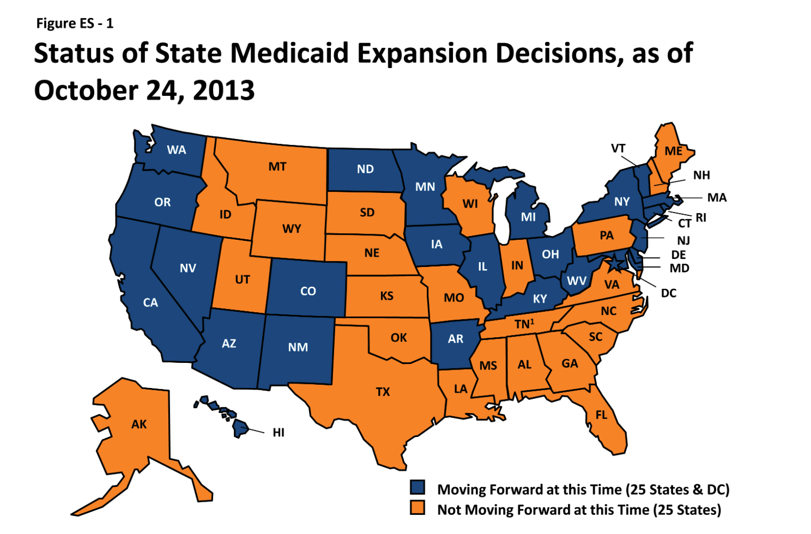
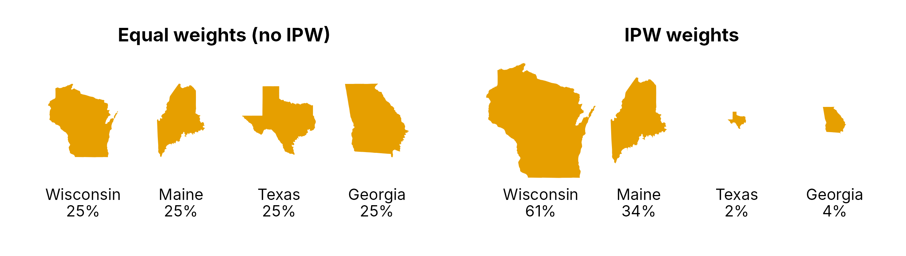

```{r}
#| label: setup
#| cache: false

library(tidyverse)
library(fixest)
library(modelsummary)
library(patchwork)
library(fastDummies)

options(scipen = 999)

theme_set(theme_minimal(base_size = 16) +
          theme(plot.title = element_text(face = "bold", size = 18),
                plot.subtitle = element_text(size = 13, color = "gray40"),
                panel.grid.minor = element_blank()))
```


## Econometrics So Far

- Started with the "gold standard" of causal inference: **RCTs**
- Then moved to **Multivariate OLS** and (even better) **fixed effects** with panel data
- Last time, started discussion on **DiD**: Using *control units* instead of *control variables*
- This time: more on DiD
  - Data-driven matching (IPW-DiD)
  - Dynamic DiD and event studies
  - Cluster-robust standard errors


# Data-Driven Matching


## Last Time: Choosing Controls by Intuition {.smaller}

- How do we know which control units to use? There is no one clear answer!
- It is common to start with some **intuition**: what "seems like" they should be a good fit?
- Card (1990) uses intuition: it "seems like" Atlanta, Tampa, LA, etc. would be a good fit for Miami
- **Border designs:** compare neighbors on opposite sides of a policy border
  - Neighbors share local economic conditions, so they are more likely to be on **parallel trends**
  - Card and Krueger (1994): fast-food restaurants in NJ vs. nearby eastern PA
  - Dube, Lester, and Reich (2010) extend this idea to *all* county pairs on state borders with different minimum wages (PS3 Q3 replicates a follow-up, Allegretto et al. 2017)


## Second Method: Data-Driven Selection of Controls {.smaller}

- An alternative: choose controls based on "data-driven" methods
- Use an algorithm to find "good" controls based on observable variables
- **The idea:** units that look alike on observable variables are more likely to share the same *trends*, so parallel trends is more believable among them

- There are *lots* of methods: synthetic controls, nearest-neighbors, propensity scores, etc.
- All share the same goal; they differ in the algorithm used
- We will focus on: **Inverse Propensity Score Weighted DiD (IPW-DiD)**


## IPW-DiD: The Example {.smaller}

- In 2014, many states expanded Medicaid eligibility under the ACA
- Suppose we want to estimate the **effect of Medicaid expansion on the uninsured rate**, using the same TWFE DiD as Unit 12:

$$
y_{it} = \delta D_{it} + a_i + \tau_t + \mu_{it}
$$

- $y_{it}$ is the uninsured rate in state $i$ in year $t$; $D_{it} = 1$ for expansion states from 2014 on

. . .

**The problem:** states which expanded Medicaid are *very different* from those that did not

- Different politics, different demographics, different incomes, etc.
- Using *all* non-expansion states as controls may give us a poor counterfactual
- In particular: if these characteristics also affect *trends* in uninsured rates, parallel trends will fail


```{r}
#| label: sim-data
#| output: false

# ==============================================================================
# Simulation: ACA Medicaid Expansion
# ==============================================================================
set.seed(8675309)

n_states <- 200
years <- 2010:2018
policy_year <- 2014
true_att <- -5.0

# Generate state characteristics
states <- tibble(
  state_id = 1:n_states,
  X1 = rnorm(n_states, mean = 0, sd = 1),
  X2 = rbinom(n_states, 1, 0.4),
  X3 = rnorm(n_states, mean = 12, sd = 3)
) |>
  mutate(
    linear_pred = -0.5 + 1.5 * X1 - 1.2 * X2 + 0.3 * (X3 - 12),
    prob_expand = plogis(linear_pred),
    is_expanded = rbinom(n(), 1, prob_expand)
  )

# Generate panel data
panel_data <- expand_grid(state_id = states$state_id, year = years) |>
  left_join(states, by = "state_id") |>
  mutate(
    post = if_else(year >= policy_year, 1, 0),
    treat_active = is_expanded * post,
    alpha_i = 15 + rnorm(n_states, 0, 2)[state_id],
    lambda_t = -0.5 * (year - 2010),
    trend_violation = (-0.8 * X1 + 0.5 * X2 - 0.2 * (X3 - 12)) * (year - 2010),
    epsilon = rnorm(n(), 0, 1.5),
    y0 = alpha_i + lambda_t + trend_violation + epsilon,
    y1 = y0 + true_att,
    uninsured_rate = if_else(treat_active == 1, y1, y0)
  )

panel_data <- panel_data |>
  mutate(treat_post = treat_active,
         dem_share = X1,
         region = X2,
         pov_rate = X3)

aca_exp_data <- panel_data |>
  select(state_id, year, is_expanded,
    post, treat_post,
    uninsured_rate,
    dem_share, region, pov_rate)
```


## ACA Expansion Map

{fig-align="center" width="50%"}


## ACA Expansion: Non-Parallel Pre-Trends {.smaller}

```{r}
#| label: naive-trends
#| fig-height: 3.8

plot_data_naive <- panel_data |>
  group_by(year, is_expanded) |>
  summarize(mean_y = mean(uninsured_rate), .groups = 'drop') |>
  mutate(Group = if_else(is_expanded == 1, "Treated", "Control"))

ggplot(plot_data_naive, aes(x = year, y = mean_y, color = Group, linetype = Group)) +
  geom_line(linewidth = 1.2) +
  geom_point(size = 2.5) +
  geom_vline(xintercept = 2013.5, linetype = "dotted") +
  scale_color_manual(values = c("Control" = "#E69F00", "Treated" = "#0072B2")) +
  labs(x = "Year", y = "Mean Uninsured Rate (%)",
    title = "Expansion States vs. All Non-Expansion States",
    subtitle = "Generated using simulated data")
```

. . .

- States which expanded Medicaid follow very different trends compared to all non-expansion states
- Pre-trends are clearly not parallel --- bad news for our DiD estimate!

## Choosing Better Control States {.smaller}

- We know that using *all* non-expansion states as controls is unwise
    - Violation of parallel trends $\rightarrow$ bad estimate
- So what can we do?
- Idea: use states which **look like they should have** expanded Medicaid **but didn't** as controls
- Why?
  - States which were highly likely to expand but didn't (maybe due to some last-minute change, a fluke in the political process, etc.) are much more *similar* to states which did expand
  - Therefore, they are more likely to form a "good" counterfactual


## Estimating Propensity Scores {.smaller}

- How do we find which states were "more likely" to expand?
- Estimate the following model:

. . .

$$
P(D_{i} = 1 | x_1, ..., x_k) = G(\beta_0 + \beta_1 x_1 + ... + \beta_k x_k)
$$

. . .

where:

- $D_{i}$ is an indicator equal to $1$ if a unit is in the treatment group (i.e., treated at any time)
- $P(D_{i} = 1 | x_1, ..., x_k)$ is the *probability of being in the treatment group conditional on $x$ variables*
- $G()$ is a non-linear function, usually the **logit** (Unit 10)
- After estimating this regression, compute the *predicted probability of treatment,* $\hat{P_i}$, also called the **propensity score**


## From Predicted Probabilities to Weights {.smaller}

- Then compute the **inverse propensity weight** and use it as a *weight* in TWFE DiD:

. . .

$$
IPW_i = D_i + (1 - D_i)\frac{\hat{P_i}}{1 - \hat{P_i}}
$$

. . .

- If a unit is **treated** ($D_i=1$): $IPW_i = 1$
- If a unit is **untreated** ($D_i=0$): $IPW_i = \frac{\hat{P_i}}{1 - \hat{P_i}}$, which is large when $\hat{P_i}$ is large and small when $\hat{P_i}$ is small

. . .

- In other words:
  - Untreated units that *look like* they should have been treated (but didn't) get **a lot of weight** as a control
  - Untreated units that look *nothing like* treated units get **very little weight** as a control
- The weighted controls look like the **treated** group, so IPW-DiD still estimates the **ATT**


## Propensity Score Example {.smaller}

- Whether or not a state expands Medicaid is probably a function of (at least):
  - Democratic vote share, region, and poverty rates (Democrats and poorer states were more supportive; neighbors tend to follow neighbors)

. . .

$$
P(D_i = 1) = G(\beta_0 + \beta_1 dem\_share_i + \beta_2 region_i + \beta_3 pov\_rate_i)
$$

. . .

- Some illustrative propensity scores ($\hat{P_i}$) and IPW weights ($IPW_i$):

. . .

| State | Status | $\hat{P_i}$ | $IPW_i$ |
|:-----:|:------:|:-----------:|:-------:|
| MI    | Treated | 0.91 | 1.00 |
| WI    | Control | 0.87 | **6.69** |
| TX    | Control | 0.16 | 0.19 |
| ME    | Control | 0.79 | **3.76** |
| MA    | Treated | 0.98 | 1.00 |
| GA    | Control | 0.28 | 0.39 |


## What the Weights Do {.smaller}

- Without IPW, every control state counts equally in the construction of the counterfactual. With IPW, controls that *look like* treated states (**WI**, **ME**) count much more; controls that don't (**TX**, **GA**) barely count

. . .

{fig-align="center"}

. . .

::: {.callout-important}
## Key Point
IPW upweights control units which *likely should have got treated but didn't* and downweights *control units which were never going to be treated.* This builds a better counterfactual.
:::


## Let's Implement This Step-by-Step {.smaller}

- In our simulated data (200 simulated "states"), the **true effect** of expansion is a $-5$ point drop in the uninsured rate

**Step 1:** Estimate the naive TWFE DiD (all controls, equal weight)

```{r}
#| echo: true

did_naive <- feols(uninsured_rate ~ treat_post | state_id + year,
                   vcov = "HC1",
                   data = aca_exp_data)

summary(did_naive)
```

. . .

- The coefficient suggests a $\approx 11$ ppt reduction in the uninsured rate
- The estimate is roughly *twice as large* as it should be.


## Step 2: Aggregate Data & Estimate Propensity Scores {.smaller}

- It's usually a good idea to estimate propensity scores on *just pre-treatment periods* (the policy itself can change later values of the $x$'s)

. . .

```{r}
#| echo: true

agg_state_data <- aca_exp_data |>
  filter(post == 0) |>
  group_by(state_id, is_expanded) |>
  summarize(pretreat_dem_share = mean(dem_share, na.rm = TRUE),
    pretreat_region = mean(region, na.rm = TRUE),
    pretreat_pov_rate = mean(pov_rate, na.rm = TRUE)
  ) |>
  ungroup()

logit_treatment <- glm(
  is_expanded ~ pretreat_dem_share + pretreat_region + pretreat_pov_rate,
  data = agg_state_data, family = binomial("logit"))
```

## Step 3: Get Predicted Probabilities & Compute IPW {.smaller}

```{r}
#| echo: true

# Get predicted probabilities (propensity scores)
agg_state_data <- agg_state_data |>
  mutate(pred_prob = predict(logit_treatment, type = "response"))

# Compute IPW weights
agg_state_data <- agg_state_data |>
  mutate(ipw = case_when(
    is_expanded == 1 ~ 1,
    is_expanded == 0 ~ pred_prob / (1 - pred_prob)
  ))

# Merge weights into panel data
aca_exp_data <- aca_exp_data |>
  left_join(agg_state_data |>
    select(state_id, is_expanded, pred_prob, ipw),
    by = c("state_id", "is_expanded"))
```


## Check Propensity Score Overlap {.smaller}

- We need treated and control propensity scores to **overlap**: wherever there are treated states, we need control states with similar $\hat{P_i}$

. . .

```{r}
#| fig-height: 4
ggplot(agg_state_data, aes(x = pred_prob, fill = factor(is_expanded))) +
  geom_histogram(bins = 25, alpha = 0.6, position = "identity", color = "white") +
  scale_fill_manual(values = c("0" = "#E69F00", "1" = "#0072B2"),
                    labels = c("Control", "Treated")) +
  labs(x = "Estimated Propensity Score", y = "Count",
    title = "Propensity Score Distributions by Treatment Status",
    subtitle = "Few control states have scores above 0.75",
    fill = NULL)
```

- Here, overlap is thin at the top: only 3 control states (vs. 26 treated) have $\hat{P_i} > 0.75$, so those few get very large weights


## Step 4: Estimate IPW-Weighted TWFE DiD {.smaller}

- Use the `weights` argument from `feols()` to weight the control units in the regression

. . .

```{r}
#| echo: true

did_ipw <- feols(uninsured_rate ~ treat_post | state_id + year,
                 vcov = "HC1",
                 weights = ~ipw,
                 data = aca_exp_data)

summary(did_ipw)
```

. . .

- Now we get an estimated treatment effect of $\approx -6$ ppts --- much closer to the true effect of $-5$!


## Comparing Naive vs. IPW: The Trends {.smaller}

```{r}
#| fig-height: 4.2
plot_data_ipw <- aca_exp_data |>
  group_by(year, is_expanded) |>
  summarize(mean_y = weighted.mean(uninsured_rate, w = ipw), .groups = 'drop') |>
  mutate(type = "IPW-Weighted", Group = if_else(is_expanded == 1, "Treated", "Control"))

plot_data_naive_f <- plot_data_naive |>
  mutate(type = "Naive (Unweighted)")

plot_both <- bind_rows(plot_data_naive_f, plot_data_ipw) |>
  mutate(type = factor(type, levels = c("Naive (Unweighted)", "IPW-Weighted")))

ggplot(plot_both, aes(x = year, y = mean_y, color = Group, linetype = Group)) +
  geom_line(linewidth = 1.1) +
  geom_point(size = 2) +
  geom_vline(xintercept = 2013.5, linetype = "dotted") +
  facet_wrap(~type) +
  scale_color_manual(values = c("Treated" = "#0072B2", "Control" = "#E69F00")) +
  labs(x = "Year", y = "Mean Uninsured Rate (%)",
    title = "Naive vs. IPW-Weighted Trends",
    subtitle = "IPW narrows the gap in pre-trends, but doesn't close it")
```

- Before 2014, the IPW-weighted controls are much closer to the treated states' trend, but not parallel: that leftover gap is why we're still about 1 point off


## Comparing Naive vs. IPW: The Estimates {.smaller}

```{r}
# CIs use standard errors clustered by state (covered at the end of the unit)
ci_naive <- confint(did_naive, cluster = ~state_id)
ci_ipw <- confint(did_ipw, cluster = ~state_id)

tibble(
    Method = c("Naive DiD (all controls, equal weight)", "IPW-Weighted DiD"),
    Estimate = c(coef(did_naive)["treat_post"], coef(did_ipw)["treat_post"]),
    `95% CI Lower` = c(ci_naive["treat_post", 1], ci_ipw["treat_post", 1]),
    `95% CI Upper` = c(ci_naive["treat_post", 2], ci_ipw["treat_post", 2]),
    `True Effect` = c(-5, -5)
) |>
    knitr::kable(digits = 2, format.args = list(nsmall = 2))
```

. . .

- The naive 95% CI doesn't even contain the true effect of $-5$!
- The IPW estimate is much closer to the truth, and its CI covers $-5$

## Leave Out a Variable {.smaller}

- Our propensity score model used Democratic vote share, region, and poverty rate
- Suppose we **left one of them out** of the logit. Which omission would hurt the IPW-DiD estimate most? Why?

. . .

```{r}
#| label: try-omit

try_fit <- function(f) {
  ps <- glm(f, data = agg_state_data, family = binomial("logit"))
  w <- agg_state_data |>
    mutate(p = predict(ps, type = "response"),
           w = if_else(is_expanded == 1, 1, p / (1 - p))) |>
    select(state_id, w)
  m <- feols(uninsured_rate ~ treat_post | state_id + year, weights = ~w,
             data = left_join(aca_exp_data, w, by = "state_id"))
  unname(coef(m)["treat_post"])
}

tibble(
  `Propensity score model` = c("All three variables", "Without Democratic vote share",
                               "Without poverty rate", "Without region"),
  `IPW-DiD estimate` = c(
    try_fit(is_expanded ~ pretreat_dem_share + pretreat_region + pretreat_pov_rate),
    try_fit(is_expanded ~ pretreat_region + pretreat_pov_rate),
    try_fit(is_expanded ~ pretreat_dem_share + pretreat_region),
    try_fit(is_expanded ~ pretreat_dem_share + pretreat_pov_rate)),
  `True effect` = -5
) |>
  knitr::kable(digits = 2)
```

. . .

- Leaving out a variable that drives *both* expansion *and* trends in the uninsured rate brings the bias back


## IPW-DiD: Key Takeaways {.smaller}

- DiD assumes parallel trends. This often fails if treated and control units are systematically different

- IPW puts more weight on controls which were **highly likely to be treated but were not** --- they are more similar to the treated units

- **The Algorithm:**
  1. Estimate predicted probability of treatment (propensity score) using pre-treatment data
  2. Compute IPW from predicted probabilities and treatment status
  3. Check that treated and control propensity scores overlap
  4. Use IPW as weights in TWFE DiD regression

. . .

::: {.callout-important}
Your IPW-DiD estimate is only as good as your predictive model! If you leave out an important confounder, bias remains.
:::


# Dynamic DiD


## Introduction to Dynamic DiD {.smaller}

- TWFE models can be extended to estimate a **separate** treatment effect for each period
  - If treatment starts in 2015 and we observe 2015--2018, we can estimate a different effect for each year
- Why might we want to do this?
  - Maybe the treatment effect **grows** a few years after a policy comes into effect
  - Or maybe it **diminishes** over time
- Dynamic DiD uses **relative time**: the number of periods since the event
  - If an event occurs in 2015: for **2015, 2016, 2017, ...**, relative time is **0, 1, 2, ...**
  - For **..., 2012, 2013, 2014**, relative time is **..., -3, -2, -1**


## The Dynamic DiD Model {.smaller}

- The general dynamic DiD model is:

. . .

$$
y_{it} = \sum_{k \neq -1} \delta_k D^k_{it} + a_i + \tau_t + \mu_{it}
$$

. . .

where:

- $y_{it}$, $a_i$, $\tau_t$, and $\mu_{it}$ are the same as in our TWFE model
- $D^k_{it}$ is a dummy that equals $1$ if unit $i$ is in the treated group AND period $t$ is relative time $k$, and $0$ otherwise
- **Important:** We **omit** the dummy for $k=-1$ (the period just before treatment) as the reference category
- For $k \geq 0$, $\hat{\delta}_k$ traces out the effect of the policy after adoption, *relative* to $k=-1$
- For $k \leq -2$, $\hat{\delta}_k$ traces out the "effect" *before* adoption, *relative* to $k=-1$


## Why Omit $k=-1$? {.smaller}

- Same reason we omit a reference category with any set of dummy variables --- to avoid perfect collinearity (the "dummy variable trap")
- We choose $k=-1$ because it's the natural baseline:
  - All estimates are then interpreted as the treatment effect *relative to the period just before treatment*
  - $\hat{\delta}_0$: effect in the year of treatment relative to the year before
  - $\hat{\delta}_1$: effect one year after treatment relative to the year before
  - $\hat{\delta}_{-3}$: "effect" three years before treatment relative to the year before (should be $\approx 0$!)


## Example Data Structure {.smaller}

- In a normal DiD, we have a single `treat_post` column
- In dynamic DiD, we replace it with a **dummy for each relative time period** interacted with treatment
- Shown: one treated unit (1) and one control unit (3)

. . .

```{r}
#| echo: false

did_ex_tab <- tibble(unit_id = rep(1:4, 5),
  year = c(rep(2014, 4), rep(2015, 4), rep(2016, 4), rep(2017, 4), rep(2018, 4)),
  treatment_group = rep(c(1, 1, 0, 0), 5),
  adoption_year = 2016 * treatment_group,
  post = case_when(year >= adoption_year & adoption_year > 0 ~ 1, TRUE ~ 0),
  treat_post = treatment_group * post
)

did_ex_tab <- did_ex_tab |>
  mutate(rel_t = year - 2016,
  rel_t_treat = case_when(treatment_group == 1 ~ rel_t, TRUE ~ 0))

did_ex_tab <- dummy_cols(did_ex_tab, select_columns = "rel_t_treat", remove_selected_columns = TRUE)

did_ex_tab <- did_ex_tab |>
  mutate(rel_t_treat_0 = rel_t_treat_0 * treatment_group) |>
  arrange(unit_id, rel_t)

old_width <- options(width = 120)
did_ex_tab |>
  filter(unit_id %in% c(1, 3)) |>
  select(unit_id, year, treatment_group, `rel_t_treat_-2`, `rel_t_treat_-1`,
         rel_t_treat_0, rel_t_treat_1, rel_t_treat_2) |>
  as.data.frame()
options(old_width)
```


## Dynamic DiD Example: An Environmental Policy {.smaller}

- Simulated: 50 cities, 1995--2010; 25 enact an *environmental policy* in 2005, 25 do not
- The policy's effect on manufacturing employment *grows* over time

```{r}
#| label: sim-env
#| output: false

set.seed(456)
n_cities <- 50
years_e <- 1995:2010
TREATMENT_YEAR <- 2005

panel_env <- expand.grid(city_id = 1:n_cities, year = years_e)

control_cities <- sample(1:n_cities, 25)
city_lookup <- data.frame(city_id = 1:n_cities) |>
  mutate(
    treated_group = ifelse(city_id %in% control_cities, 0, 1),
    adoption_year = ifelse(treated_group == 1, TREATMENT_YEAR, Inf)
  )

get_true_effect <- function(relative_year) {
  case_when(
    relative_year < 0 ~ 0,
    relative_year == 0 ~ -100,
    relative_year == 1 ~ -300,
    relative_year == 2 ~ -450,
    relative_year >= 3 ~ -500
  )
}

city_fes <- rnorm(n_cities, 1000, 150)
year_fes <- rnorm(length(years_e), 50, 20)

group_level_gap <- 400

final_simulated_data <- panel_env |>
  left_join(city_lookup, by = "city_id") |>
  mutate(
    city_fe = city_fes[city_id] + treated_group * group_level_gap,
    year_fe = year_fes[year - min(years_e) + 1],
    relative_year = year - adoption_year,
    true_effect = get_true_effect(relative_year),
    manufacturing_emp = city_fe + year_fe + true_effect + rnorm(n(), 0, 50)
  ) |>
  select(city_id, year, treated_group, adoption_year, manufacturing_emp)

final_simulated_data <- final_simulated_data |>
  mutate(post = case_when(year >= 2005 ~ 1, TRUE ~ 0),
    treat_post = treated_group * post,
    rel_t = year - 2005,
    rel_t_treat = case_when(treated_group == 1 ~ rel_t, TRUE ~ 0))

final_simulated_data <- dummy_cols(final_simulated_data,
  select_columns = "rel_t_treat", remove_selected_columns = FALSE)

final_simulated_data <- final_simulated_data |>
  mutate(rel_t_treat_0 = rel_t_treat_0 * treated_group)


final_simulated_data <- final_simulated_data |>
  mutate(rel_t_treat.f = as.factor(rel_t_treat),
    rel_t_treat.f = relevel(rel_t_treat.f, ref = "-1"))

```

```{r}
#| fig-height: 4.2
env_trends <- final_simulated_data |>
  group_by(year, treated_group) |>
  summarize(mean_emp = mean(manufacturing_emp), .groups = 'drop') |>
  mutate(Group = if_else(treated_group == 1, "Treated Cities", "Control Cities"))

ggplot(env_trends, aes(x = year, y = mean_emp, color = Group)) +
  geom_line(linewidth = 1.2) +
  geom_point(size = 2.5) +
  geom_vline(xintercept = 2004.5, linetype = "dashed", color = "gray40") +
  annotate("text", x = 2004.3, y = 1150, label = "Policy\nAdopted", hjust = 1, size = 4) +
  scale_color_manual(values = c("Control Cities" = "#E69F00", "Treated Cities" = "#0072B2")) +
  labs(x = "Year", y = "Mean Manufacturing Employment",
    title = "Manufacturing Employment: Treated vs. Control Cities",
    subtitle = "Parallel pre-trends, then growing divergence after 2005")
```

::: aside
Note: figure generated using simulated data. True effects: $-100$ at $k=0$, growing to $-500$ by $k=3$.
:::


## Estimating the Dynamic Model {.smaller}

```{r}
#| echo: true

dyn_did <- feols(manufacturing_emp ~ `rel_t_treat_-10` + `rel_t_treat_-9` +
    `rel_t_treat_-8` + `rel_t_treat_-7` + `rel_t_treat_-6` +
    `rel_t_treat_-5` + `rel_t_treat_-4` + `rel_t_treat_-3` +
    `rel_t_treat_-2` + `rel_t_treat_0` + `rel_t_treat_1` +
    `rel_t_treat_2` + `rel_t_treat_3` + `rel_t_treat_4` +
    `rel_t_treat_5` |
    city_id + year,
    vcov = "HC1",
    data = final_simulated_data)
```

- Note: we leave `rel_t_treat_-1` (the period right before treatment) out of the formula: it's the reference category
- Each coefficient = treatment effect at that relative time, compared to $k = -1$

## Interpreting the Results {.smaller}

```{r}
#| echo: true

summary(dyn_did)
```


## Interpreting the Coefficients {.smaller}

Each $\hat{\delta}_k$ is the estimated treatment effect at relative time $k$, **relative to $k = -1$**

- $\hat{\delta}_{-3} \approx -30$: Three years before adoption, treated cities had 30 fewer manufacturing jobs than control cities *compared to one year before adoption*. Not statistically different from zero $\rightarrow$ no sign of a pre-trend.

- $\hat{\delta}_0 \approx -119$: In the adoption year, treated cities lost about 120 manufacturing jobs relative to control cities *compared to one year before adoption*. Statistically significant!

- $\hat{\delta}_3 \approx -500$: Three years after adoption, the gap had grown to about 500 fewer jobs. Statistically significant!

. . .

**Key points:**

- The coefficients are *not* the level of employment --- they are *differences* between treated and control, benchmarked to the period just before the policy

- If $\hat{\delta}_{-5} = 0$ and $\hat{\delta}_{-2} = 0$ but $\hat{\delta}_0 = -100$, that's the pattern parallel trends predicts: nothing happening pre-treatment, then a break at the policy date


## Pre-Treatment Results and Parallel Trends {.smaller}

- Why estimate effects *before* the policy occurs? To check for **pre-trends**: evidence for (not proof of) our key assumption, **parallel trends**
  - This is what Card (1990) couldn't show with only one pre-period year

. . .

- $\hat{\delta}_{-3}$ is the treated--control gap at $k = -3$ relative to the gap at $k = -1$. If both groups were on the same trajectory, the gap wasn't changing $\rightarrow$ $\hat{\delta}_{-3} \approx 0$
- If the pre-treatment $\hat{\delta}_k$'s are large and significant, the groups were drifting apart *before* the policy: any post-treatment divergence might just continue that trend

. . .

- Here, 8 of our 9 pre-treatment coefficients are close to zero. $\hat{\delta}_{-10}$ is significant at 5%, but with 9 tests, one false positive is not unusual: no *pattern* $\rightarrow$ **good evidence for parallel trends**

::: {.callout-warning}
A *pattern* of significant pre-treatment coefficients (e.g., a steady drift): **red flag!** Your control group is probably not valid
:::


## The Event-Study Plot {.smaller}

- Often, it is hard to read that many coefficients, so we plot them as an **event-study plot**
- We plot each coefficient (setting $k=-1$ to $0$) with its 95% confidence interval

. . .

```{r}
#| fig-height: 3.7

est_tab <- as_tibble(dyn_did$coeftable) |>
  rownames_to_column(var = "coefname") |>
  mutate(
    est = Estimate,
    ci95_l = confint(dyn_did)[,1],
    ci95_u = confint(dyn_did)[,2],
    rel_t = c(-10:-2, 0:5))

omitted_lvl <- tibble(coefname = "ref", rel_t = -1, est = 0,
  ci95_l = 0, ci95_u = 0, Estimate = 0)

est_tab <- est_tab |>
  bind_rows(omitted_lvl) |>
  arrange(rel_t)

ggplot(data = est_tab) +
  geom_hline(yintercept = 0, linetype = "solid", color = "gray60") +
  geom_vline(xintercept = -0.5, linetype = "dashed", color = "gray40") +
  geom_errorbar(aes(x = rel_t, ymin = ci95_l, ymax = ci95_u),
    width = 0.2, color = "#0072B2", linewidth = 0.8) +
  geom_point(aes(x = rel_t, y = est), size = 3, color = "#0072B2") +
  geom_line(aes(x = rel_t, y = est), color = "#0072B2", linewidth = 0.8) +
  coord_cartesian(ylim = c(-700, 300)) +
  scale_x_continuous(breaks = seq(-10, 5, 1)) +
  labs(x = "Years Relative to Policy Adoption",
    y = "Estimated Effect on Employment",
    title = "Event Study: Environmental Policy & Manufacturing Employment",
    subtitle = "Reference period: k = -1 (one year before adoption)")
```

- **Left of the dashed line:** the pre-trends check. **Right of it:** the policy's effect, growing over time


## A Warning: Staggered Adoption {.smaller}

- Our example was "simple": all treated cities adopted the policy in the same year (2005)
- This is called **simultaneous adoption**
- What if units are treated in different years? (e.g., some cities in 2005, others in 2007, more in 2010)
- This is **staggered adoption**, and it's common: the real Medicaid expansion was staggered (most states in 2014; PA and IN in 2015; LA in 2016; more since)

. . .

::: {.callout-warning}
Under staggered adoption, simple TWFE (static or dynamic) can be very biased **when treatment effects change over time or differ across adoption groups**, like our environmental policy, whose effect grows. TWFE implicitly uses already-treated units as controls for later-treated units, creating "negative weights" on some treatment effects. Use methods built for staggered adoption: `sunab()` in `fixest` (Sun and Abraham) or the Callaway-Sant'Anna estimator in the `did` package.
:::


## Dynamic DiD: Key Takeaways

1. Dynamic DiD estimates treatment effects that **evolve over time**

2. The model uses **relative time** ($k$), not calendar time

3. We **omit** $k=−1$ (period just before treatment) as the reference category

4. Pre-treatment coefficients ($k < -1$) check for **pre-trends**: evidence for parallel trends, not proof --- they should be $\approx 0$, with no pattern

5. Present your results using an **event study plot**

6. The simple TWFE model can **fail under staggered adoption** when effects change over time


# Cluster-Robust Standard Errors


## The Core Problem: An Intuitive Example {.smaller}

- Imagine you want to know the average height of 5th graders in a city

- You have two sampling options:

- **Plan A (Simple Random Sample):** Randomly select 1,000 5th graders from across the whole city

- **Plan B (Cluster Sample):** Randomly select 40 classrooms and measure all 25 students in each

- Both plans give you $N = 1{,}000$ observations. But are they the same?

- **No!** In Plan B, students in the same class are more similar to each other (shared teacher, neighborhood, etc.). They are not *independent!*


## What is a "Cluster"? {.smaller}

- A **cluster** is a group of observations that are more similar to each other than to observations in other groups

- Errors from our regression are *correlated within the cluster*

- But errors from our regression are still *independent between clusters*

. . .

| Individual unit ($n$) | Cluster ($G$) |
|:-------------------:|:-----------:|
| Student             | Classroom   |
| Person              | State (or county) |
| City                | State       |
| Firm                | Industry    |
| State-year (panel data) | State   |

- Why is this a problem for our standard errors?


## The Statistical Violation {.smaller}

- This violates **GM2 (random sampling)**: observations are no longer independent (heteroskedasticity broke GM5 in Unit 9)
- If one student in a class has a higher *error term*, her classmates probably do too $\rightarrow$ correlated errors within each cluster

. . .

- Just like **heteroskedasticity**, clustered errors will **not bias** your coefficient estimate $\hat{\beta}$
- But our usual standard errors are often far **too small**: t-statistics too big, p-values too small, confidence intervals too narrow

. . .

- This leads to **Type I errors (false positives)**: concluding there is an effect when, in reality, there is none
- We usually accept a 5% false positive rate ($\alpha = 0.05$). Ignoring clustering can push it far higher...
- ...all while R tells us the p-value is 0.03!


## Why DiD Needs Clustered SEs {.smaller}

- DiD follows the *same states* over *many years*: a state's errors are correlated from year to year, so each state is a cluster
- Bertrand, Duflo, and Mullainathan (2004) made up **fake ("placebo") state laws**, assigned at random, and estimated their "effects" on women's wages with DiD

. . .

- The laws were fake, so the true effect was zero. Yet with about 20 years of state-level data, the usual standard errors found a "significant" effect at 5% for **up to 45% of the fake laws**
- Their fix: allow errors to be correlated within each state (cluster by state)


## Simulation: Setup {.smaller}

- Let's see how bad this problem gets with a simulation
- We generate data where the **true treatment effect is zero**, so *any* rejection of $H_0$ is a **Type I error**
- Treatment is assigned to **whole clusters** (like a state policy): every student in a classroom is treated, or none is

. . .

| Parameter | Value | Meaning |
|:----------|:-----:|:--------|
| Number of clusters ($G$) | 50 | e.g., 50 classrooms |
| Observations per cluster | 30 | e.g., 30 students per classroom |
| Total observations ($N$) | 1,500 | $50 \times 30$ |
| ICC | 0.5 | 50% of the variation in $y$ is between clusters |
| True treatment effect | **0** | Treatment does *nothing* |
| Number of simulations | 1,000 | We repeat the experiment 1,000 times |

. . .

- Each time: run `feols(y ~ treatment)`, get p-values with **naive (iid)** and **HC1** standard errors, and check whether we reject $H_0$ at $\alpha = 0.05$


## What Does Clustered Data Look Like? {.smaller}

- Here is one draw (8 classrooms, for clarity). Students in the same classroom share a common error component, and the whole classroom is either treated or not

. . .

```{r}
#| label: cluster-scatter
#| fig-height: 3.5

set.seed(12345980)

# Generate one draw for visualization (fewer clusters for readability)
n_show <- 8
obs_show <- 30
icc_show <- 0.5

cluster_var <- icc_show
indiv_var <- 1 - icc_show

viz_data <- tibble(
  cluster_id = rep(1:n_show, each = obs_show),
  cluster_error = rep(rnorm(n_show, 0, sqrt(cluster_var)), each = obs_show),
  treatment = rep(rbinom(n_show, 1, 0.5), each = obs_show),
  individual_error = rnorm(n_show * obs_show, 0, sqrt(indiv_var)),
  y = 5 + 0 * treatment + cluster_error + individual_error
) |>
  mutate(Treatment = if_else(treatment == 1, "Treated classroom", "Control classroom"))

ggplot(viz_data, aes(x = factor(cluster_id), y = y, color = Treatment)) +
  geom_jitter(width = 0.2, height = 0, size = 2, alpha = 0.6) +
  stat_summary(fun = mean, geom = "crossbar", width = 0.6, color = "black", linewidth = 0.4) +
  scale_color_manual(values = c("Control classroom" = "#E69F00", "Treated classroom" = "#0072B2")) +
  labs(x = "Classroom", y = "Y", color = NULL,
    title = "Clustered Data: Students Bunch Within Classrooms",
    subtitle = "Black bars = classroom means. The true treatment effect is zero")
```

- OLS treats all 240 dots as independent, but each classroom is closer to *one* piece of information about treatment

```{r}
#| label: cluster-sim

set.seed(12345980)
NUM_SIMS <- 1000
NUM_CLUSTERS <- 50
OBS_PER_CLUSTER <- 30
ICC <- 0.5
TRUE_EFFECT <- 0.0

generate_clustered_data <- function(n_clust, n_obs, icc, true_effect) {
  total_error_var <- 1
  cluster_error_var <- icc * total_error_var
  individual_error_var <- (1 - icc) * total_error_var

  cluster_id <- 1:n_clust
  cluster_error <- rnorm(n = n_clust, mean = 0, sd = sqrt(cluster_error_var))
  treatment <- rbinom(n = n_clust, size = 1, prob = 0.5)

  clusters <- data.frame(cluster_id, cluster_error, treatment)
  df <- clusters[rep(clusters$cluster_id, each = n_obs), ]
  df$individual_error <- rnorm(n = nrow(df), mean = 0, sd = sqrt(individual_error_var))
  df$y <- 5 + (true_effect * df$treatment) + df$cluster_error + df$individual_error

  return(df)
}

run_trial <- function() {
  sim_data <- generate_clustered_data(NUM_CLUSTERS, OBS_PER_CLUSTER, ICC, TRUE_EFFECT)
  model <- feols(y ~ treatment, data = sim_data)

  naive_p <- summary(model, se = "iid")$coeftable["treatment", "Pr(>|t|)"]
  hc1_p <- summary(model, vcov = "HC1")$coeftable["treatment", "Pr(>|t|)"]
  cluster_p <- summary(model, cluster = ~cluster_id)$coeftable["treatment", "Pr(>|t|)"]

  return(c(naive_p = naive_p, hc1_p = hc1_p, cluster_p = cluster_p))
}

results <- t(replicate(NUM_SIMS, run_trial()))
alpha <- 0.05
naive_rej <- mean(results[, "naive_p"] < alpha)
hc1_rej <- mean(results[, "hc1_p"] < alpha)
cluster_rej <- mean(results[, "cluster_p"] < alpha)

# Same simulation, but treatment assigned to individual students (Try It slide)
run_trial_ind <- function() {
  sim_data <- generate_clustered_data(NUM_CLUSTERS, OBS_PER_CLUSTER, ICC, TRUE_EFFECT)
  sim_data$treatment <- rbinom(nrow(sim_data), 1, 0.5)
  model <- feols(y ~ treatment, data = sim_data)

  naive_p <- summary(model, se = "iid")$coeftable["treatment", "Pr(>|t|)"]
  cluster_p <- summary(model, cluster = ~cluster_id)$coeftable["treatment", "Pr(>|t|)"]

  return(c(naive_p = naive_p, cluster_p = cluster_p))
}

results_ind <- t(replicate(NUM_SIMS, run_trial_ind()))
naive_rej_ind <- mean(results_ind[, "naive_p"] < alpha)
cluster_rej_ind <- mean(results_ind[, "cluster_p"] < alpha)
```


## Results: Naive OLS and HC1 {.smaller}

```{r}
cat("--- Type I Error Rate (Expected: 5%) ---\n\n")
cat(sprintf("1. Naive (iid) Standard Errors:              %.1f%%\n", naive_rej * 100))
cat(sprintf("2. Heteroskedasticity-Robust (HC1) Errors:   %.1f%%\n", hc1_rej * 100))
```

. . .

- Naive OLS: **massive** over-rejection. We are committing Type I errors far more than 5% of the time
- HC1 (our usual `vcov = "HC1"` fix): still way too many false positives!
  - HC1 corrects for *heteroskedasticity* but **not** for *within-cluster correlation*
- Neither of our usual standard error approaches works here. We need something new.


## The Solution: Cluster-Robust Standard Errors {.smaller}

- **Cluster-Robust Standard Errors (CRSEs)** allow correlated errors *within* clusters (but not *between* them). Recall Unit 9's robust (HC1) formula:

$$
se(\hat{\beta}_1)^2 = \frac{\sum_{i=1}^{n} (x_i - \bar{x})^2 \, (\hat{\mu}_i)^2}{SST_x^2}
$$

. . .

- CRSEs **add up within each cluster $g$ first**, then square:

$$
se(\hat{\beta}_1)^2 = \frac{\sum_{g=1}^{G} \left( \sum_{i \in g} (x_i - \bar{x}) \, \hat{\mu}_i \right)^2}{SST_x^2}
$$

. . .

- If treatment is the same for everyone in a cluster, so is $(x_i - \bar{x})$: correlated errors pile up instead of canceling $\rightarrow$ a bigger SE
- **Rule of thumb:** the "effective sample size" is closer to $G$ than to $N$ (here, about 100, not 1,500)


## CRSEs in R {.smaller}

- With `fixest`, implementing CRSEs is easy
- Instead of `vcov = "HC1"`, use `cluster = "your_cluster_var"`

. . .

```{r}
#| echo: true
#| eval: false

# Naive standard errors (WRONG with clustered data)
model <- feols(y ~ treatment, data = my_data, vcov = "iid")

# Heteroskedasticity-robust (ALSO WRONG with clustered data)
model <- feols(y ~ treatment, data = my_data, vcov = "HC1")

# Cluster-robust standard errors (CORRECT)
model <- feols(y ~ treatment, data = my_data, cluster = "cluster_id")
```

. . .

- The researcher must decide what the clusters are: more on this shortly


## Now Let's See If CRSEs Fix the Problem {.smaller}

```{r}
#| fig-height: 3.6
results_long_all <- as_tibble(results) |>
  pivot_longer(everything(), names_to = "method", values_to = "pvalue") |>
  mutate(method = case_when(
    method == "naive_p" ~ "1. Naive (iid)",
    method == "hc1_p" ~ "2. HC1 (Heteroskedasticity-Robust)",
    method == "cluster_p" ~ "3. Cluster-Robust"
  ))

ggplot(results_long_all, aes(x = pvalue, fill = method)) +
  geom_histogram(bins = 20, alpha = 0.7, color = "white") +
  geom_vline(xintercept = 0.05, linetype = "dashed", color = "red") +
  facet_wrap(~method, ncol = 3) +
  annotate("text", x = 0.2, y = 140, label = "alpha == 0.05", parse = TRUE,
           color = "red", size = 3.5) +
  scale_fill_manual(values = c("1. Naive (iid)" = "#E69F00",
                                "2. HC1 (Heteroskedasticity-Robust)" = "#D55E00",
                                "3. Cluster-Robust" = "#0072B2")) +
  labs(x = "P-Value", y = "Count",
    title = "P-Value Distributions Under the Null (True Effect = 0)",
    subtitle = sprintf("Type I error rates --- Naive: %.0f%% | HC1: %.0f%% | Cluster-Robust: %.0f%%",
                      naive_rej * 100, hc1_rej * 100, cluster_rej * 100)) +
  theme(legend.position = "none")
```

- Under $H_0$, p-values should be spread evenly (a flat histogram). Naive and HC1: they pile up near zero
- **Cluster-robust SEs: roughly flat, with a Type I error rate close to the target 5%!**
- Even with correct SEs, 5% of tests reject by chance: remember $\hat{\delta}_{-10}$ in our event study?


## Try It: Assign Treatment to Students {.smaller}

- Same simulation, one change: assign treatment to **individual students** instead of whole classrooms (the ICC is still 0.5)
- Predict: what happens to the naive (iid) Type I error rate? Do we still need to cluster?

. . .

```{r}
cat("--- Type I Error Rate, treatment assigned to students (Expected: 5%) ---\n\n")
cat(sprintf("1. Naive (iid) Standard Errors:              %.1f%%\n", naive_rej_ind * 100))
cat(sprintf("2. Cluster-Robust Standard Errors:           %.1f%%\n", cluster_rej_ind * 100))
```

. . .

- Correlated errors alone aren't the problem. It's correlated errors **plus** a treatment that is the same for everyone in the cluster
- That's why we **cluster at the level of treatment assignment**


## CRSEs in the ACA Example {.smaller}

- Medicaid expansion is a **state-level** policy, so we cluster by state. Here is our IPW-DiD:

. . .

```{r}
#| echo: true

did_ipw_crse <- feols(uninsured_rate ~ treat_post | state_id + year,
                      cluster = "state_id",
                      weights = ~ipw,
                      data = aca_exp_data)

summary(did_ipw_crse)
```

- The coefficient is unchanged ($-6.24$): clustering does not affect the point estimate
- The SE roughly doubles (HC1: 0.38), so the 95% CI widens to include the true $-5$. These are the CIs in our naive vs. IPW table


## Choosing the Right Cluster Level {.smaller}

- So, *like* heteroskedasticity-robust SEs, easy to correct for
- But *unlike* heteroskedasticity-robust SEs, we have to choose how we think the clusters are defined
  - City data: cluster at the city-level? State-level? County?
  - Individual data: hospital-level? County-level?
- **General rule: cluster at the level of treatment assignment**
  - State-level policy $\rightarrow$ cluster by state; school-level program $\rightarrow$ cluster by school
  - Panel data: each unit's observations over time form a cluster
- You generally need at least 30--50 clusters for CRSEs to work well
  - With only 2 cities, as in Card (1990), clustering can't work: that's why we skipped those SEs in Unit 12
- When in doubt, cluster at a broader level (e.g., state rather than county) --- this will usually result in more conservative SEs


## CRSEs: Key Takeaways

- **Clustering is everywhere:** Data often comes in groups (classrooms, states, individuals over time)

- **Ignoring it is dangerous:** It leads to a massive inflation of **Type I errors** (false positives)

- **Use cluster-robust standard errors:** They provide reliable inference by relaxing the independence assumption

- **Cluster at the level of treatment assignment** (e.g., state-level policy $\rightarrow$ cluster by state)

- You generally need at least 30--50 clusters for CRSEs to work well

